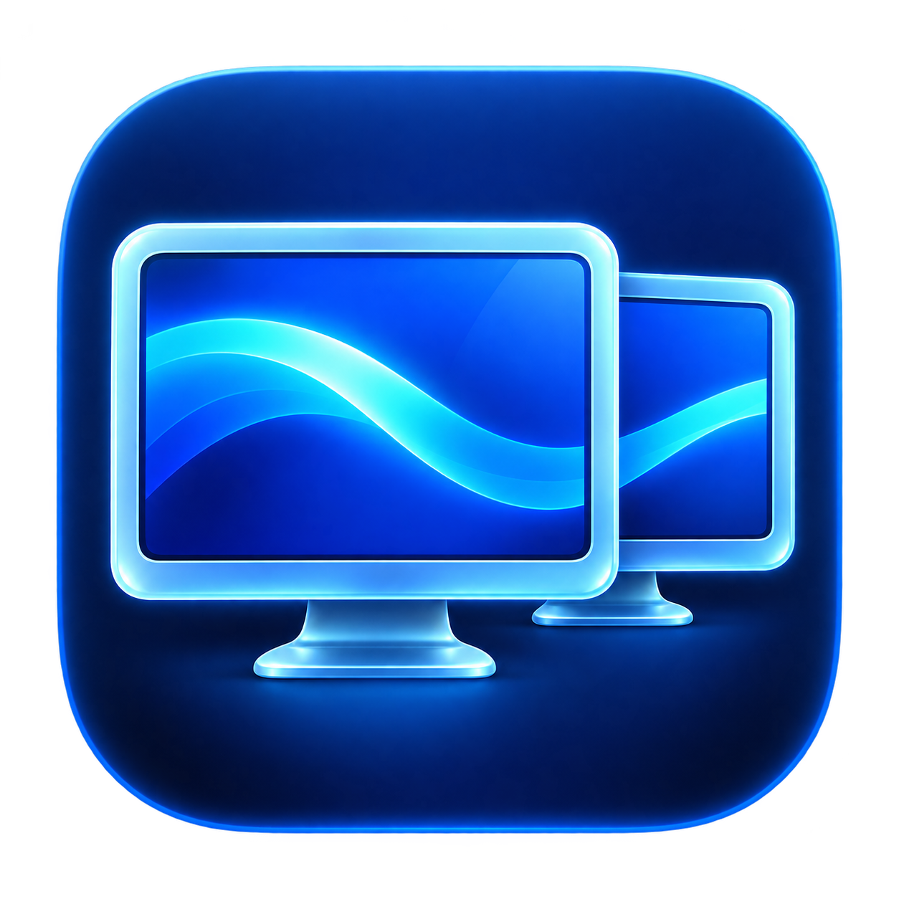
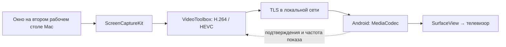

# Голубой экран / Blue Screen



Экспериментальное приложение, превращающее Android TV в **отдельный второй рабочий стол Mac** по локальной сети. Окна можно переносить между экраном ноутбука и телевизором.

**Mac: 0.7.0. Android TV: 0.7.0. Изображение работает; раздельный звук ещё не реализован.**

## Что умеет

- Подключает до трёх независимых виртуальных экранов; хранит список ранее добавленных телевизоров и мониторов.
- Показывает «В сети / Оффлайн» у каждого экрана (доступность фоновой службы приёмника).
- Получает режимы от Android TV и проверяет их поддержку аппаратным H.264/HEVC-декодером.
- Автоматически выбирает наибольшее разрешение и максимальную частоту для него; позволяет вручную выбрать другой доступный режим.
- Располагает экраны только слева, сверху или справа от MacBook. На каждой стороне может быть один подключённый экран; занятая сторона исключается из выбора остальных.
- Захватывает только второй экран через ScreenCaptureKit.
- Кодирует H.264 или HEVC аппаратно через VideoToolbox и передаёт по TLS 1.2.
- Приёмник Android TV декодирует видео аппаратно через MediaCodec и показывает его в SurfaceView.
- Сохраняет название телевизора и IP. Код нужен только при первом сопряжении, цифры при вводе видны.
- После перезапуска обеих программ подключается одной кнопкой, без повторного кода.
- Сохраняет для каждого экрана название, IP, режим и расположение. Параметры доступны в карточке выбранного экрана; служебные счётчики остаются в тестах.
- При разрыве соединения останавливает захват и удаляет виртуальный экран.
- Перед сном Mac отключает все экраны и возвращает TV на домашний экран; далее действуют обычные настройки заставки TV. После пробуждения предлагает восстановить прежние подключения.
- На Xiaomi учитывает физическое разрешение панели, даже когда Android сообщает только разрешение интерфейса; для 4K использует аппаратный HEVC.

В 0.7 на Xiaomi MiTV-MOOQ1 обнаружены режимы до **3840 × 2160 / 60 Гц**. В 15-секундном тесте реального захвата, HEVC, TLS и аппаратного декодирования после разгона измерено около **60 кадров/с** (последние выборки 59,998–60,004). На исходном стике доступен Full HD / 59,94 Гц. Два физических приёмника подключены одновременно; три виртуальных дисплея и ограничения размещения проверены отдельно. Пользователь подтвердил сценарий настоящего сна и пробуждения Mac. Три физических TV одновременно и длительная нагрузка 4K не проверены. Приватные журналы и снимки не публикуются.

## Как это работает



На Mac запускается отправитель «Голубой экран», на стике — отдельное приложение «Голубой экран TV». ADB используется для установки и разработки; в передаче изображения он не участвует. Интернет-сервер, учётная запись и платный сервис для работы приложения не нужны.

## Требования

- Mac с Apple Silicon; минимальная цель сборки macOS 14.2, фактически проверена macOS 27.0.1.
- Xcode Command Line Tools с поддержкой Swift и SDK macOS.
- Android TV / стик с Android 11 (API 30) или новее, аппаратным H.264/HEVC-декодером. Доступные режимы определяются как пересечение режимов TV и возможностей декодера, в пределах 3840 × 2160 и 120 Гц.
- Mac и Android TV в одной доступной локальной сети.
- Для сборки Android: JDK с javac/java/jar, Android SDK Platform 34, Build Tools 35.0.0, platform-tools (adb), zip.

## Сборка

Из корня проекта на Mac:

```sh
zsh build.sh
zsh Android/build.sh
zsh Tools/install-macos.sh
```

Результаты:

- `/Applications/Голубой экран.app` — установленное приложение. Запуск: Finder → «Программы» → «Голубой экран».
- `build/BlueScreen.app` — промежуточная сборка с постоянной локальной подписью. Для обычной работы запускайте установленную копию.
- `Android/build/BlueScreen-TV.apk` — отладочный APK с локальной подписью.

Android SDK по умолчанию ищется в `$HOME/Library/Android/sdk`; иной путь задаётся через `ANDROID_HOME`. JDK выбирается из `JAVA_HOME` либо `/usr/libexec/java_home`. Скрипт при первой сборке создаёт локальный `Android/build/development.keystore` со стандартным паролем разработки `android`. Это не ключ публичного релиза; он не входит в Git. Для обновлений установленного APK используйте тот же локальный ключ.

Зависимости Bouncy Castle 1.86 включены в `Android/lib/` вместе с лицензией и контрольными суммами. Проверка из корня проекта:

```sh
shasum -a 256 -c Android/lib/SHA256SUMS
```

## Установка и подключение

1. Установите APK на своё тестовое устройство через авторизованный ADB:

   ```sh
   adb -s DEVICE_SERIAL install -r Android/build/BlueScreen-TV.apk
   ```

2. На телевизоре откройте **«Все приложения» → «Голубой экран TV»** с пульта. Появятся номер устройства и код. Разрешите «Поверх других приложений» по кнопке приёмника: это нужно, чтобы сохранённый Mac мог вернуть приёмник из фона после сна. Первое сопряжение выполняется с открытым приложением.
3. На Mac откройте **«Программы» → «Голубой экран»**. Разрешите запись экрана и доступ к локальной сети в системных настройках macOS.
4. Нажмите «Добавить экран», укажите название и IP телевизора. Выберите его в списке и нажмите «Подключиться». В первый раз сверьте номер устройства на обоих экранах, введите видимый код и подтвердите. Название и IP сохраняются; следующие подключения выполняются одной кнопкой, в том числе после перезапуска обеих программ.
5. Выберите режим (по умолчанию — автоматический максимум) до подключения. Расположение относительно MacBook можно менять и во время передачи. Перенесите окно в выбранную сторону или используйте стандартное меню macOS перемещения окна на экран с указанным вами названием.
6. Добавьте другие экраны так же. Сохранённых экранов может быть больше трёх, одновременно подключённых — не более трёх. Для завершения нажмите «Отключиться» в карточке нужного экрана. Возврат на главный экран Android закрывает текущую передачу, но фоновая служба продолжает ожидать подключения. Кнопка «Выключить приёмник» останавливает и службу.

Статусы обновляются примерно раз в 5–7 секунд. «Оффлайн» означает, что приложение-приёмник недоступно, даже если телевизор включён. Меню «… → Удалить из списка» удаляет профиль; «Забыть подключение» отдельно удаляет сохранённый доступ. Текущий профиль версии 0.5 переносится в новый список автоматически.

Сборка создаёт постоянный локальный сертификат в `.local-signing/` внутри проекта. Каталог содержит закрытый ключ, исключён из Git и должен сохраняться между обновлениями. Две разные сборки проверяются командой `zsh Tools/check-signing.sh`: их идентичность должна совпадать и быть привязана к сертификату. Для собственного Developer ID задайте `BLUESCREEN_SIGNING_IDENTITY`. При переходе со старой ad hoc-подписи macOS может один раз повторно запросить ранее выданные доступы к экрану и Keychain; при сохранении сертификата последующие сборки не меняют идентичность. Локальный сертификат не заменяет Developer ID и нотариализацию публичного релиза. Номер TV сохраняется между перезапусками. «… → Забыть подключение» на Mac удаляет локальное доверие; «Забыть все Mac» на TV отзывает доступ сохранённых Mac. После очистки данных приёмника потребуется новое сопряжение.

## Проверки

`build.sh` запускает проверки геометрии экранов, определения окон и валидации адресов. `Android/build.sh` проверяет парсер протокола и подпись APK.

Дополнительные проверки:

```sh
# Три независимых дисплея, геометрия, автоподбор, профили и предел подключений.
zsh Tools/check-monitors.sh

# Создаёт реальный виртуальный экран и окно; проверяет отключение.
build/virtual-screen-checks

# Проверяет преобразование H.264 и производительность кодировщика.
xcrun swiftc -parse-as-library -swift-version 5 -O -target arm64-apple-macosx14.2 Sources/DisplayMode.swift Sources/VideoEncoder.swift Tests/VideoEncoderChecks.swift -o build/video-encoder-checks
build/video-encoder-checks

# На собственном авторизованном устройстве: отказ при неверном коде, без изображения.
python3 Tests/test_tv_auth.py --host TV_IP --serial DEVICE_SERIAL

# Первое сопряжение, перезапуск TV, возврат без PIN, отказ неверному токену.
python3 Tests/test_pairing.py --host TV_IP --serial DEVICE_SERIAL

# Возврат на Home, сохранение доступности и возобновление из фона без PIN.
python3 Tests/test_background_resume.py --host TV_IP --serial DEVICE_SERIAL

```

Для измерений всего тракта см. [архитектуру и протокол](docs/architecture.md).

## Совместимость приёмника

Проверены Android 11 на исходном тестовом стике и Xiaomi MiTV-MOOQ1. На обоих устройствах 0.7 проверены возврат на Home по отключению, доступность службы в фоне и её запуск по сохранённому токену. На Xiaomi проверено изображение второго рабочего стола 4K / 60 Гц с HEVC; проверки TLS и сохранённого доверия предыдущей версии остаются в тестах.

Некоторые прошивки создают RSA-ключ в AndroidKeyStore, но Conscrypt не может использовать его в TLS. При характерной внутренней RSA-ошибке 0.6.1 автоматически использует постоянную идентичность в закрытом no-backup хранилище приложения — тот же резервный механизм, который уже применялся при ошибке создания ключа. TLS остаётся включённым. AndroidKeyStore-ключи нового формата используют отдельный alias v2; если ранее был сопряжён приёмник с аппаратным alias v1, после такого обновления потребуется заново сверить номер и выполнить сопряжение. Уже сохранённая резервная идентичность не меняется.

## Ограничения

- **Звук остаётся на Mac.** Автоматическое независимое направление звука двух окон одного браузера — открытая задача. Маршрутизация всего браузера не считается решением этого требования.
- CGVirtualDisplay — непубличный механизм macOS. Совместимость с будущими версиями ОС и распространение через App Store не подтверждены.
- Поддержка всех браузеров, моделей TV, DRM, тяжёлого видео и длительной нагрузки не доказана. Сквозная задержка не измерена. Максимальный заявленный режим не гарантирует его стабильную частоту: результат зависит также от Mac, Wi-Fi и числа потоков. Три физических приёмника одновременно пока не тестировались.
- На тестовом стике аппаратный видеослой не попадает в Android-снимок экрана. Чёрная область на снимке может не соответствовать изображению физического TV.
- Автоматического переподключения после обрыва нет: нажмите «Подключиться». Для сохранённого телевизора код повторно не нужен. При изменении IP укажите новый адрес и выполните сопряжение для него.
- Это исходники рабочего прототипа, не готовый универсальный продукт. Публичных подписанных релизов нет; локальная установка выполняется включённым скриптом.

## Структура

| Каталог | Назначение |
| --- | --- |
| `Sources/` | Список/профили экранов, доступность, режимы/геометрия, виртуальные дисплеи, захват, кодировщик, TLS |
| `Android/src/` | Android-приёмник, аппаратный декодер и протокол |
| `Tests/`, `Android/Tests/` | Локальные и интеграционные проверки |
| `Assets/`, `Android/res/` | Иконка приложения |
| `Tools/` | Помощник виртуального дисплея и ранние диагностические инструменты Cast |
| `docs/architecture.md` | Устройство сеанса, протокол, воспроизведение измерений |

## Лицензия

Код проекта — [MIT](LICENSE). Bouncy Castle распространяется по собственной разрешительной [лицензии](Android/lib/LICENSE.html). Иконка создана с помощью imagegen; описание и промпт — [Assets/icon-design.md](Assets/icon-design.md).
