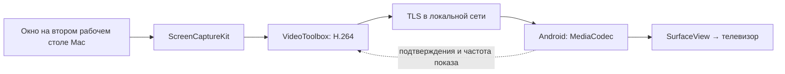

# Голубой экран / Blue Screen


Экспериментальное приложение, превращающее Android TV в **отдельный второй рабочий стол Mac** по локальной сети. Окна можно переносить между экраном ноутбука и телевизором.

**Текущая версия: 0.5.0. Изображение работает; раздельный звук ещё не реализован.**

## Что умеет

- Создаёт виртуальный экран 1920 × 1080 справа от Mac.
- Захватывает только второй экран через ScreenCaptureKit.
- Кодирует H.264 аппаратно через VideoToolbox и передаёт по TLS 1.2.
- Приёмник Android TV декодирует видео аппаратно через MediaCodec и показывает его в SurfaceView.
- Сохраняет название телевизора и IP. Код нужен только при первом сопряжении, цифры при вводе видны.
- После перезапуска обеих программ подключается одной кнопкой, без повторного кода.
- В обычном окне показывает телевизор, название, IP и подключение; служебные счётчики доступны в тестах.
- При разрыве соединения останавливает захват и удаляет виртуальный экран.

В версии 0.4 на тестовом стенде с Android 11 при номинальном режиме 1080p60 видеовывод работал на 59,94006 Гц. За 90 секунд теста движущегося окна после разгона измерено **59,937–59,942 кадра/с**, медиана **59,940**. Это результат конкретного стенда, а не гарантия такой частоты на любом TV или при любой нагрузке. Метод измерения — MediaCodec.OnFrameRenderedListener, окно 2 секунды, выборка раз в секунду. В 0.5 проверены передача изображения и новое сопряжение; длительный замер FPS не повторялся. Приватные журналы и снимки в репозиторий не включены.

## Как это работает



На Mac запускается отправитель «Голубой экран», на стике — отдельное приложение «Голубой экран TV». ADB используется для установки и разработки; в передаче изображения он не участвует. Интернет-сервер, учётная запись и платный сервис для работы приложения не нужны.

## Требования

- Mac с Apple Silicon; минимальная цель сборки macOS 14.2, фактически проверена macOS 27.0.1.
- Xcode Command Line Tools с поддержкой Swift и SDK macOS.
- Android TV / стик с Android 11 (API 30) или новее, аппаратным H.264-декодером, поддерживающим 1920 × 1080 при 60 кадрах/с.
- Mac и Android TV в одной доступной локальной сети.
- Для сборки Android: JDK с javac/java/jar, Android SDK Platform 34, Build Tools 35.0.0, platform-tools (adb), zip.

## Сборка

Из корня проекта на Mac:

```sh
zsh build.sh
zsh Android/build.sh
zsh Tools/install-macos.sh
```

Результаты:

- `/Applications/Голубой экран.app` — установленное приложение. Запуск: Finder → «Программы» → «Голубой экран».
- `build/BlueScreen.app` — промежуточная сборка с локальной ad hoc-подписью. Для обычной работы запускайте установленную копию.
- `Android/build/BlueScreen-TV.apk` — отладочный APK с локальной подписью.

Android SDK по умолчанию ищется в `$HOME/Library/Android/sdk`; иной путь задаётся через `ANDROID_HOME`. JDK выбирается из `JAVA_HOME` либо `/usr/libexec/java_home`. Скрипт при первой сборке создаёт локальный `Android/build/development.keystore` со стандартным паролем разработки `android`. Это не ключ публичного релиза; он не входит в Git. Для обновлений установленного APK используйте тот же локальный ключ.

Зависимости Bouncy Castle 1.86 включены в `Android/lib/` вместе с лицензией и контрольными суммами. Проверка из корня проекта:

```sh
shasum -a 256 -c Android/lib/SHA256SUMS
```

## Установка и подключение

1. Установите APK на своё тестовое устройство через авторизованный ADB:

   ```sh
   adb -s DEVICE_SERIAL install -r Android/build/BlueScreen-TV.apk
   ```

2. На телевизоре откройте **«Все приложения» → «Голубой экран TV»** с пульта. Появятся номер устройства и код.
3. На Mac откройте **«Программы» → «Голубой экран»**. Разрешите запись экрана и доступ к локальной сети в системных настройках macOS.
4. Укажите название и IP телевизора, нажмите «Подключиться». В первый раз сверьте номер устройства на обоих экранах, введите видимый код и подтвердите. Название и IP сохраняются; следующие подключения выполняются одной кнопкой, в том числе после перезапуска обеих программ.
5. Перенесите нужное окно вправо на второй рабочий стол или используйте стандартное меню macOS перемещения окна на BlueScreen TV.
6. Для завершения нажмите «Отключиться». Возврат на главный экран Android закрывает приёмник и соединение.

После пересборки ad hoc-подпись меняется: macOS может потребовать обновить разрешение записи экрана и перезапустить приложение. Системную защиту обходить не требуется. Номер TV сохраняется между перезапусками. «… → Забыть подключение» на Mac удаляет локальное доверие; «Забыть все Mac» на TV отзывает доступ сохранённых Mac. После очистки данных приёмника потребуется новое сопряжение.

## Проверки

`build.sh` запускает проверки геометрии экранов, определения окон и валидации адресов. `Android/build.sh` проверяет парсер протокола и подпись APK.

Дополнительные проверки:

```sh
# Создаёт реальный виртуальный экран и окно; проверяет отключение.
build/virtual-screen-checks

# Проверяет преобразование H.264 и производительность кодировщика.
xcrun swiftc -parse-as-library -swift-version 5 -O -target arm64-apple-macosx14.2 Sources/VideoEncoder.swift Tests/VideoEncoderChecks.swift -o build/video-encoder-checks
build/video-encoder-checks

# На собственном авторизованном устройстве: отказ при неверном коде, без изображения.
python3 Tests/test_tv_auth.py --host TV_IP --serial DEVICE_SERIAL

# Первое сопряжение, перезапуск TV, возврат без PIN, отказ неверному токену.
python3 Tests/test_pairing.py --host TV_IP --serial DEVICE_SERIAL

```

Для измерений всего тракта см. [архитектуру и протокол](docs/architecture.md).

## Ограничения

- **Звук остаётся на Mac.** Автоматическое независимое направление звука двух окон одного браузера — открытая задача. Маршрутизация всего браузера не считается решением этого требования.
- CGVirtualDisplay — непубличный механизм macOS. Совместимость с будущими версиями ОС и распространение через App Store не подтверждены.
- Поддержка всех браузеров, моделей TV, DRM, тяжёлого видео и длительной нагрузки не доказана. Сквозная задержка не измерена.
- На тестовом стике аппаратный видеослой не попадает в Android-снимок экрана. Чёрная область на снимке может не соответствовать изображению физического TV.
- Автоматического переподключения после обрыва нет: нажмите «Подключиться». Для сохранённого телевизора код повторно не нужен. При изменении IP укажите новый адрес и выполните сопряжение для него.
- Это исходники рабочего прототипа, не готовый универсальный продукт. Публичных подписанных релизов нет; локальная установка выполняется включённым скриптом.

## Структура

| Каталог | Назначение |
| --- | --- |
| `Sources/` | SwiftUI-интерфейс, виртуальный дисплей, захват, кодировщик, TLS |
| `Android/src/` | Android-приёмник, аппаратный декодер и протокол |
| `Tests/`, `Android/Tests/` | Локальные и интеграционные проверки |
| `Assets/`, `Android/res/` | Иконка приложения |
| `Tools/` | Помощник виртуального дисплея и ранние диагностические инструменты Cast |
| `docs/architecture.md` | Устройство сеанса, протокол, воспроизведение измерений |

## Лицензия

Код проекта — [MIT](LICENSE). Bouncy Castle распространяется по собственной разрешительной [лицензии](Android/lib/LICENSE.html). Иконка создана с помощью imagegen; описание и промпт — [Assets/icon-design.md](Assets/icon-design.md).
